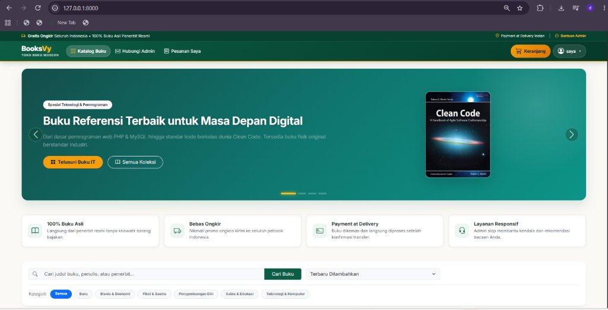
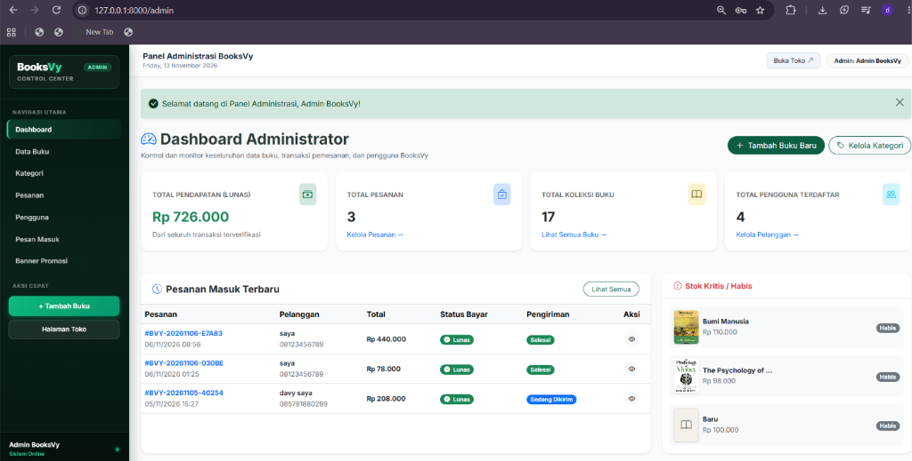
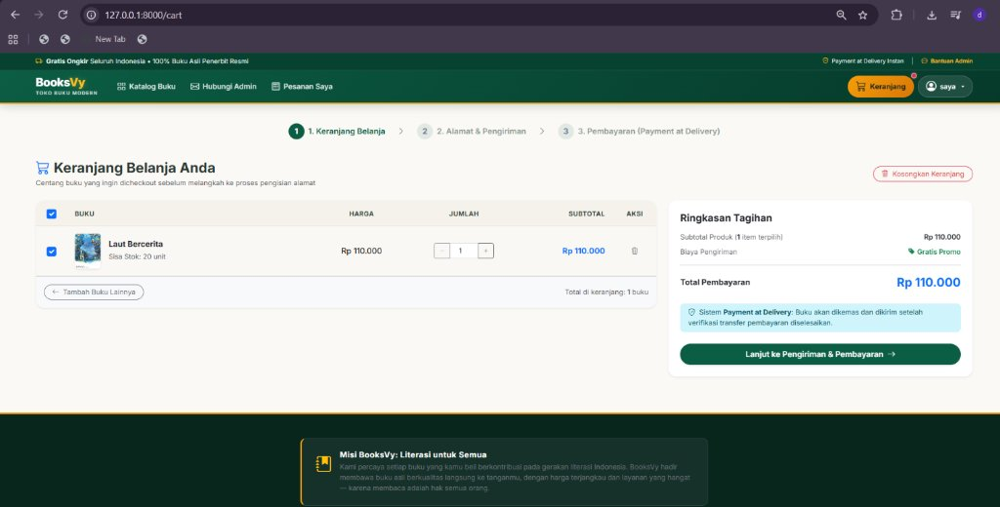
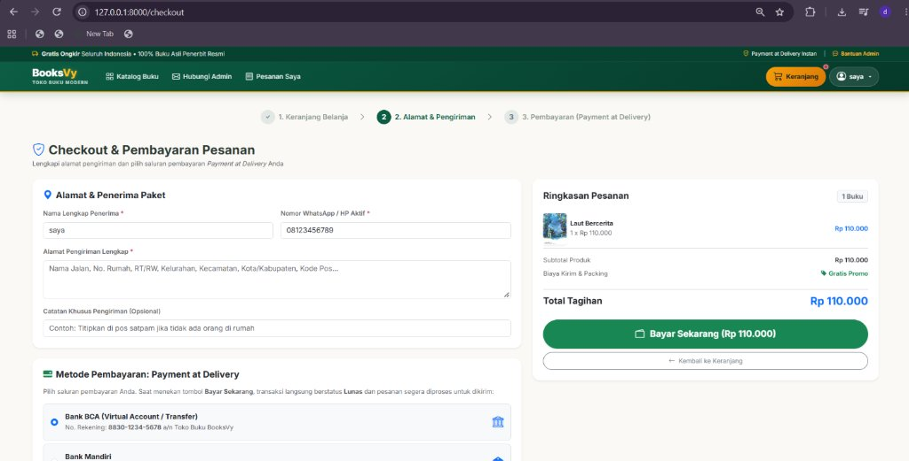
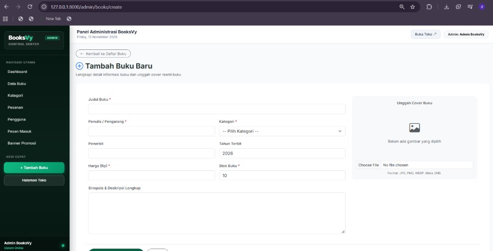
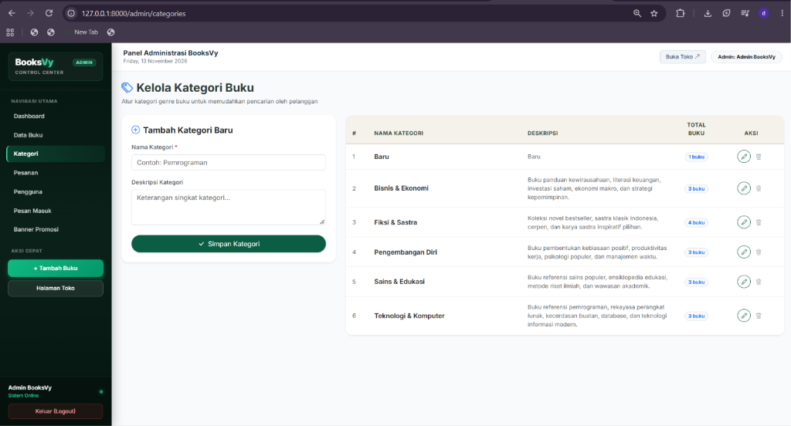
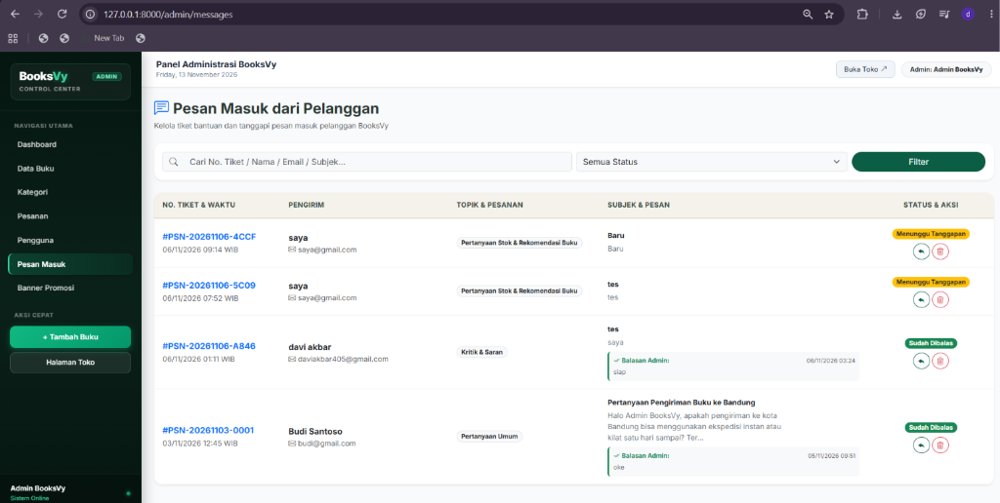
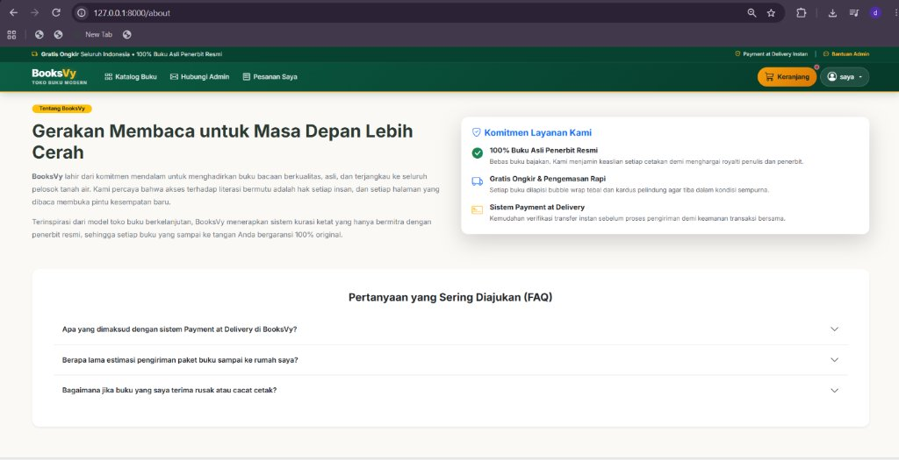
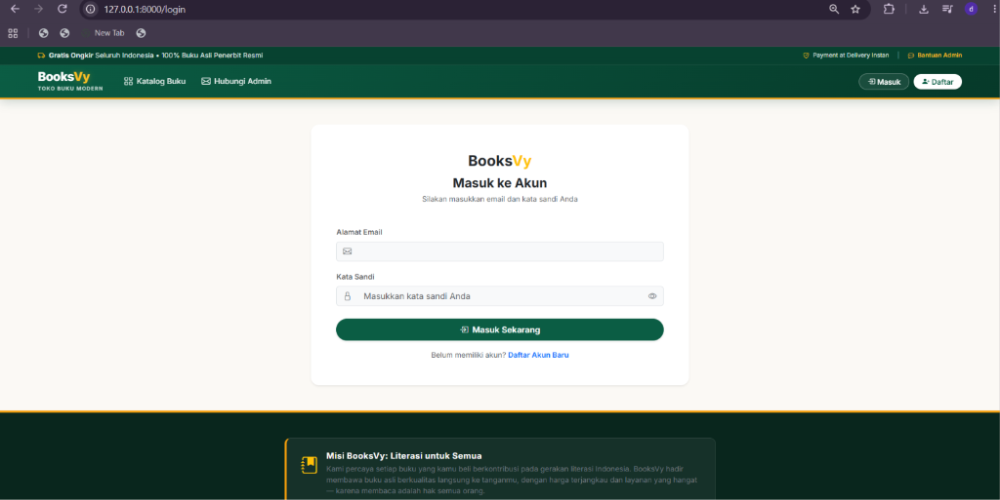
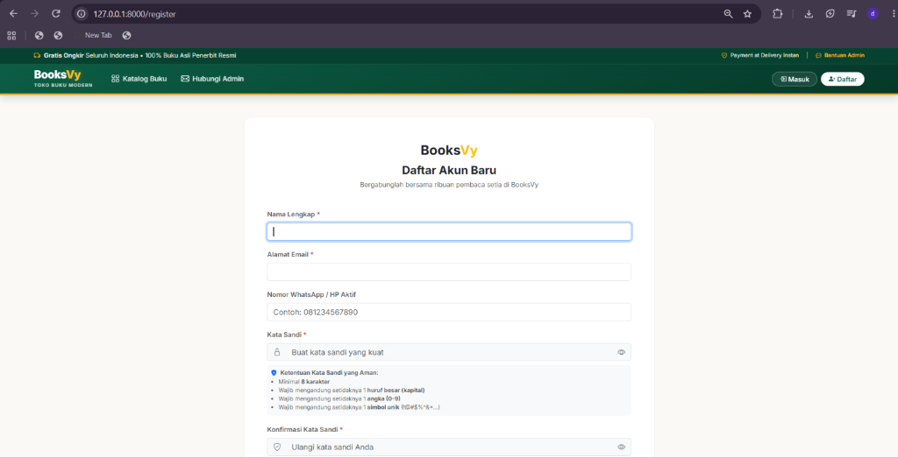

# 📚 BooksVy - Toko Buku Online Modern

<p align="center">
  
</p>

<p align="center">
  
  
  
  
</p>

---

## 📖 Tentang Aplikasi
**BooksVy** adalah platform toko buku online modern berbasis web yang dibangun menggunakan **Laravel 12** dan **MySQL**. Aplikasi ini dirancang dengan antarmuka yang elegan bertema *Forest Pine & Emerald*, responsif, serta mendukung pengalaman pengguna yang intuitif mulai dari eksplorasi katalog, keranjang belanja interaktif tanpa reload halaman (AJAX), transaksi *Payment at Delivery*, hingga panel kontrol administrasi lengkap.

---

## 🌟 Fitur Utama

### 🛒 Sisi Pengguna (Pelanggan / Customer)
- **Tampilan Penuh & Dinamis:** Menyesuaikan secara mulus pada layar monitor desktop lebar (5–6 kolom buku per baris).
- **Katalog Buku & Pencarian Real-time:** Filter berdasarkan genre kategori, pencarian judul/penulis/penerbit, dan sortir harga.
- **Detail Buku & Smart Stock Sync:** Validasi ketersediaan stok riil yang sinkron otomatis dengan item yang sudah ada di keranjang.
- **Keranjang Belanja Cerdas (AJAX Counter):** Tambah, kurang (`+` / `-`), dan hapus buku seketika tanpa refresh halaman.
- **Sistem Checkout Payment at Delivery:** Pembelian aman dengan nomor invoice unik, pemilihan metode pembayaran, serta kalkulasi otomatis.
- **Riwayat Pesanan:** Memantau status transaksi dan pengiriman buku.
- **Pusat Bantuan & Tiket Kontak:** Mengirim pesan konsultasi langsung ke Administrator.

### 🛡️ Sisi Administrator (Admin Panel)
- **Modern Sidebar Dashboard:** Tata letak sidebar tetap (*fixed*) yang tidak ikut ter-scroll saat membaca tabel data.
- **Manajemen Katalog Buku (CRUD Lengkap):** Tambah buku dengan proteksi anti-duplikasi judul/penulis, edit, upload cover, serta proteksi buku tidak bisa dihapus jika masih ada stok.
- **Kelola Kategori Genre:** Proteksi kategori tidak dapat dihapus jika masih digunakan oleh buku aktif.
- **Kelola Pesanan & Transaksi:** Konfirmasi status pembayaran (*Lunas/Dibatalkan*) dan status logistik (*Sedang Dikirim/Selesai*).
- **Pesan Masuk Pelanggan:** Membaca dan menanggapi tiket pesan dari pelanggan.
- **Pop-Up Konfirmasi Interaktif (SweetAlert2):** Notifikasi pop-up modern sebelum melakukan aksi hapus data atau logout.

---

## 📸 Tangkapan Layar (Screenshots)

### 1. Halaman Depan / Landing Page


### 2. Dashboard Administrator


### 3. Keranjang Belanja (Interactive Cart)


### 4. Checkout & Transaksi


### 5. Tambah Buku Baru (Panel Admin)


### 6. Kelola Kategori Buku


### 7. Hubungi Admin & Tiket Bantuan


### 8. Pesan Masuk dari Pelanggan (Admin)


### 9. Tentang BooksVy


### 10. Autentikasi Pengguna
| Masuk (Login) | Daftar Akun (Register) |
| :---: | :---: |
|  |  |

---

## 🛠️ Teknologi yang Digunakan
- **Framework:** Laravel 12
- **Bahasa Pemrograman:** PHP 8.3+
- **Database:** MySQL
- **Frontend / Styling:** Blade Templating, Bootstrap 5.3, Bootstrap Icons, Custom CSS
- **Interaktivitas:** Vanilla JavaScript, Fetch API (AJAX), SweetAlert2
- **Web Server:** Laragon / Apache

---

## 🚀 Panduan Instalasi Lokal

1. **Clone Repository:**
   ```bash
   git clone https://github.com/davyakbr/BooksVy.git
   cd BooksVy
   ```

2. **Instal Dependensi Composer:**
   ```bash
   composer install
   ```

3. **Konfigurasi Environment:**
   Salin `.env.example` menjadi `.env` dan sesuaikan koneksi database MySQL:
   ```env
   DB_CONNECTION=mysql
   DB_HOST=127.0.0.1
   DB_PORT=3306
   DB_DATABASE=booksvy_db
   DB_USERNAME=root
   DB_PASSWORD=
   ```

4. **Generate Application Key:**
   ```bash
   php artisan key:generate
   ```

5. **Migrasi Database:**
   ```bash
   php artisan migrate
   ```

6. **Jalankan Server Lokal:**
   ```bash
   php artisan serve
   ```
   Akses di browser melalui: `http://localhost:8000`

---

## 👤 Pengembang
* **Nama Repository:** BooksVy
* **GitHub:** [@davyakbr](https://github.com/davyakbr)
